# Higor Manoel

### Product designer & creative technologist

**UI/UX, IA e front-end para transformar ideias em produtos digitais funcionais.**

Uno estratégia, direção visual e tecnologia para levar produtos da descoberta à experiência publicada.

## Design como estratégia. Tecnologia como meio de entrega.

Sou designer e diretor de arte com mais de **10 anos de experiência** em branding, motion, audiovisual, e-commerce e marketing de performance. Hoje, aplico esse repertório a produtos digitais. Combino pesquisa, design de interface e experiência do usuário (UI/UX), sistemas visuais, inteligência artificial (IA) generativa e desenvolvimento assistido por IA.

- 🧭 **Product design & UI/UX**: problemas claros, fluxos compreensíveis e interfaces orientadas ao uso real
- ⚡ **IA & creative technology**: prototipagem, geração, automação e ferramentas para ampliar a capacidade criativa
- 🎨 **Direção de arte & sistemas visuais**: identidade, consistência e hierarquia aplicadas a marcas e produtos
- 🧩 **Front-end & protótipos funcionais**: experiências responsivas que transformam decisões de design em software utilizável

> Não uso tecnologia para substituir intenção criativa. Uso tecnologia para transformar intenção em produto.

## Produto em destaque

### [Em Apuros: apuração 2026](https://emapuros.com.br)

Painel eleitoral **map-first** para acompanhar a última apuração oficial disponível das Eleições 2026. O produto transforma documentos técnicos do Tribunal Superior Eleitoral (TSE) em uma leitura territorial clara, responsiva e verificável. Não apresenta projeções nem substitui a situação oficial.

| Dimensão | O que foi desenvolvido |
| --- | --- |
| **Problema** | Permitir que qualquer pessoa compreenda o cenário nacional e explore cada estado em poucos segundos, principalmente pelo celular. |
| **Produto & UX** | Estratégia de produto, arquitetura da informação, experiência territorial, fluxos de exploração e compartilhamento. |
| **UI & design system** | Interface editorial, mapa como elemento central, hierarquia para dados densos, estados ao vivo e padrões acessíveis. |
| **Engenharia** | Descoberta e verificação de documentos oficiais assinados, cache resiliente e transição automática de cada disputa quando o TSE publica o segundo turno. |
| **Tecnologia** | TypeScript · React/Vinext · Canvas 2D · Cloudflare Workers · D1 |

[**Ver o produto em funcionamento →**](https://emapuros.com.br)

> O código permanece privado. Esta apresentação mostra as decisões de produto e a stack usada sem publicar o repositório.

## Projetos públicos

| Projeto | O que ele demonstra | Stack |
| --- | --- | --- |
| [**Brand Manual PDF**](https://github.com/higormanoel/brand-manual-pdf) | Manuais de marca editoriais gerados com design sistematizado, automação e documentação reutilizável. | HTML · CSS · Chrome |
| [**Workout PDF Generator**](https://github.com/higormanoel/workout-pdf-generator) | Ferramenta que transforma dados de treino em PDFs com direção visual, paleta automática e links interativos. | Python · PDF · Automação |
| [**PokeDev**](https://github.com/higormanoel/pokedev) | Card de contribuições com dados reais, pixel art original, SVG animado e atualização automática. | JavaScript · SVG · GitHub Actions |

## Caixa de ferramentas

## PokeDev: contribuições em pixel art

Minha atividade pública dos últimos 12 meses, transformada em um card pixel art com Charizard que atualiza automaticamente.

  

Projeto original disponível em <a href="https://github.com/higormanoel/pokedev"><strong>higormanoel/pokedev</strong></a>.

O card contabiliza commits públicos e contribuições reconhecidas pelo GitHub. Atividades privadas só aparecem quando a visibilidade de contribuições privadas está habilitada no perfil.

## Vamos construir algo relevante?

Se você trabalha com produtos digitais, marcas ou IA aplicada e procura alguém capaz de conectar estratégia, design e execução, vamos conversar.

[**Ver portfólio**](https://higormanoeldesign.com.br) · [**Conectar no LinkedIn**](https://www.linkedin.com/in/higor-manoel-89106822b/) · [**Acompanhar no Instagram**](https://instagram.com/higormanoeldesign)

